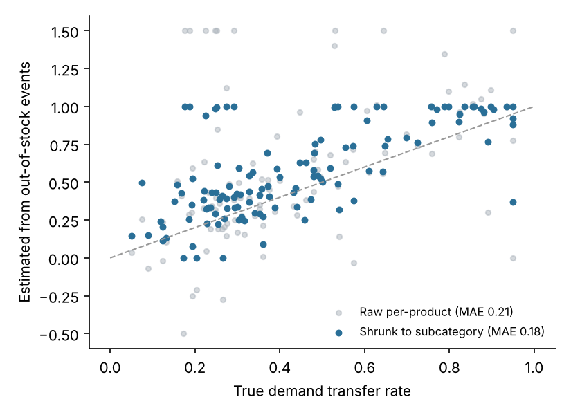

# Demand transferability for range reviews

**Question:** if we delist 15% of SKUs, which ones can go without losing the sales?

**Approach**
- **Natural experiments:** in 254 out-of-stock weeks, the extra units sold by in-stock siblings are compared with what the missing product would have sold. Both sides come from the shared demand model, so promo-heavy weeks don't have to be discarded.
- **Transfer rates** are a ratio of sums per product, shrunk toward the subcategory rate because each product has only a few events.
- **Range review:** 18 SKUs are delisted from the bottom 35% of the range, keeping at least 3 per subcategory. Lost revenue is scored with the true transfer rates.

**Results**

| Delisting rule | Revenue lost |
|---|---|
| Cut lowest sellers | 2.17% |
| **Transfer-aware (estimated)** | **1.76%** |
| Oracle (true transfer) | 1.45% |

- The transfer-aware rule reduces lost revenue by **19%** and closes 57% of the gap to the oracle.
- Shrinkage lowers transfer-rate error (MAE 0.21 to 0.18). Per-product transferability stays hard to measure from chain-level data, which is why customer-level switching data would be the next step.

Run: `python3 assortment-substitution/assortment.py`
