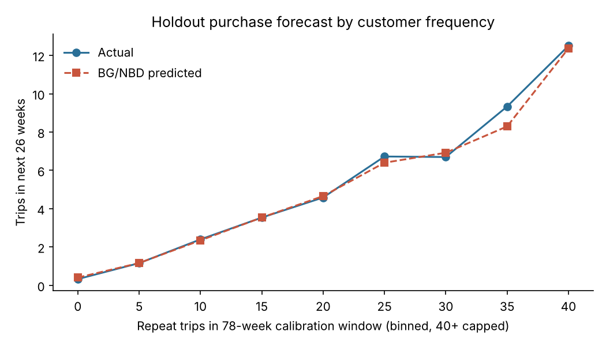

# Customer lifetime value: BG/NBD + Gamma-Gamma

**Question:** which customers will be worth the most over the next 26 weeks, and how much will the base spend in total?

**Approach**
- Trips are rolled up to recency, frequency and tenure, with 78 weeks for calibration and 26 weeks held out.
- **BG/NBD** (purchase rate plus probability of silent churn) and **Gamma-Gamma** (spend per trip) are both fitted by maximum likelihood from scratch with SciPy, without the `lifetimes` package.
- Expected 26-week value is expected trips multiplied by expected spend per trip, and is compared with a "keep spending at your past rate" baseline.

**Results (6,000 customers, holdout)**

| | CLV model | Run-rate baseline |
|---|---|---|
| Aggregate spend error | **+2.2%** | +181.7% |
| Top-decile capture of future spend | **62.2%** | 48.9% |
| Spearman rank correlation | **0.71** | 0.41 |
| Customer-level WAPE | **0.66** | 2.07 |

- Holdout trip count is within **1.1%** in aggregate.
- The run-rate baseline almost triples the forecast because it never lets anyone churn.

Run: `python3 customer-lifetime-value/clv.py`
