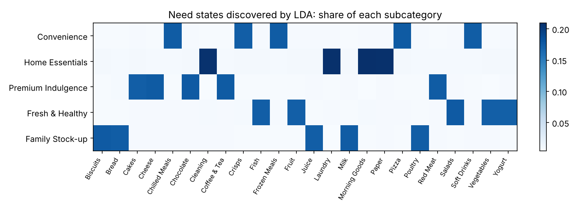

# Customer need-state segmentation with LDA

**Question:** what shopping missions do customers come in for, and how do individual customers mix them?

**Approach**
- Each customer's purchase history is treated as a document of subcategory "words", and **Latent Dirichlet Allocation** finds the missions (topics).
- Unlike hard clustering, LDA gives every customer a **mix** of missions. In the simulation, as in real data, more than half of customers have a meaningful second mission.
- Results are compared with K-means on subcategory shares and checked against the simulator's true need states and mission mixes.

**Results (4,861 customers with 20+ items)**
- Five clean need states are recovered: Fresh & Healthy, Family Stock-up, Convenience, Premium Indulgence and Home Essentials.
- Dominant-state assignment accuracy is **88.9%** (ARI 0.74), on par with K-means (ARI 0.74).
- Per-customer mission mix correlates **r = 0.90** with the truth (mean absolute error 0.076). K-means cannot produce this.
- **54%** of customers put at least 20% of their shopping into a second mission, which is the cross-sell signal a hard segment label hides.

Run: `python3 need-state-segmentation/segmentation.py`
