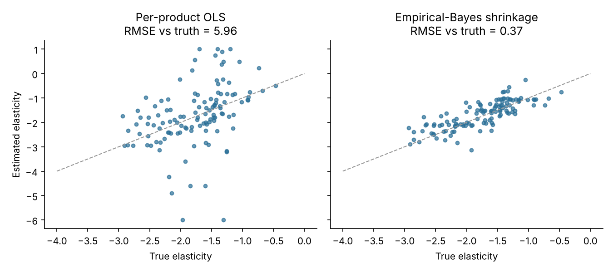

# Price elasticity and constrained price optimisation

**Question:** where can shelf prices move to grow margin without hurting revenue or price perception?

**Approach**
- Per-product elasticity from regular-price weeks only (promo weeks, post-promo weeks and out-of-stocks are excluded), controlling for seasonality and trend.
- **Empirical-Bayes shrinkage:** each product only changes shelf price a few times, so raw estimates are noisy. Each one is pulled toward its category mean in proportion to its standard error, using a robust (MAD) estimate of the between-product spread.
- **Optimisation (SLSQP) per category:** maximise gross margin with each price moving at most ±10%, category revenue at least 99% of today, and a sales-weighted price index of at most 1.02.
- Every plan is scored against the simulator's **true** demand curves, not the model's own estimates.

**Results**

| Elasticities used | Margin uplift (true demand) | Revenue change |
|---|---|---|
| Raw per-product OLS | +3.9% | −0.3% |
| **Shrunk (empirical Bayes)** | **+4.8%** | −0.6% |
| Oracle (true elasticities) | +5.3% | −0.3% |

- Elasticity RMSE against the truth falls from **5.96** to **0.37** after shrinkage.
- The shrunk plan captures **92%** of the oracle's margin gain, against 74% with raw estimates.

Run: `python3 price-optimisation/price_optimisation.py`
