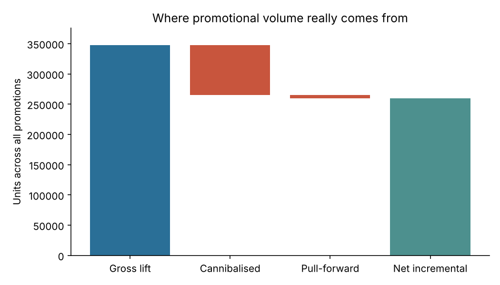

# Promotion uplift decomposition

**Question:** a promotion sold 300 extra units. How many of those were genuinely new to the business?

**Approach**
- A log-linear demand model per product with seasonality (two Fourier pairs), trend, relative price, promo and display flags, a post-promo dip term and a subcategory cannibalisation term ([`retail_sim/demand_model.py`](../retail_sim/demand_model.py)).
- Every one of the 1,488 promotions is decomposed into **gross lift**, then **cannibalised units** taken from siblings in the same subcategory, then **pull-forward** lost the following week, giving **net incremental** units.
- Incremental margin also charges the discount given away on baseline units the shopper would have bought anyway.

**Results**
- Baseline forecast on a 13-week holdout: WAPE **13.3%**, against 30.6% for a naive average.
- Recovered parameters correlate with the simulator's truth: cannibalisation r = **0.91**, elasticity r = **0.78**, pull-forward r = **0.60**.
- Only **75%** of gross promotional volume is truly incremental.
- **82%** of promotions lose margin. 10%-off deals are margin-positive on average (+77 per event), and every deeper discount is negative, down to −563 at 40% off.
- Display support adds 65% more net units per event and loses less margin than price-only promos.

**Why it matters:** gross uplift is the number promotion plans are usually judged on, and it overstates value. Netting off cannibalisation, pull-forward and subsidised baseline turns promo planning into a margin decision.

Run: `python3 promo-uplift/promo_uplift.py`
